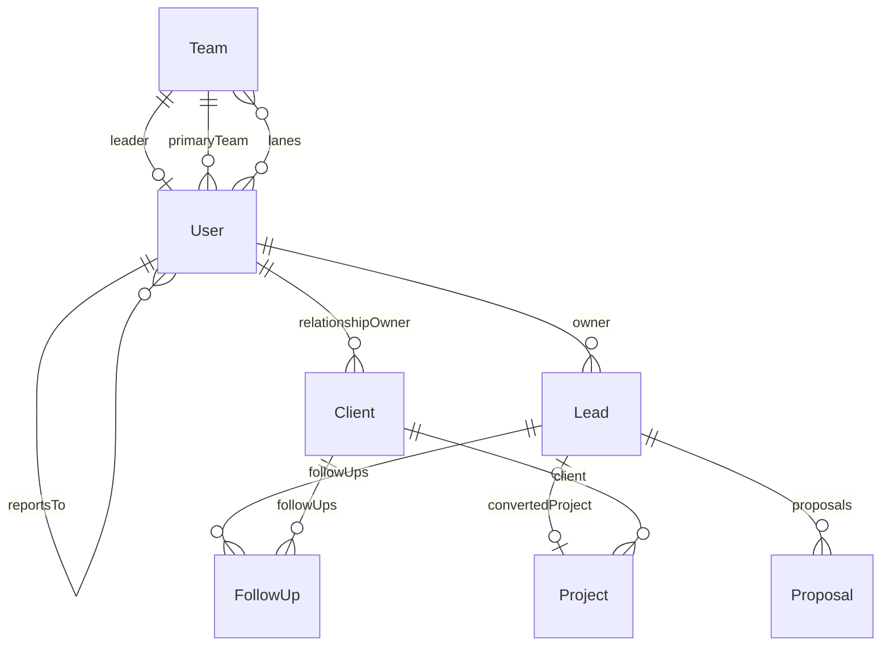
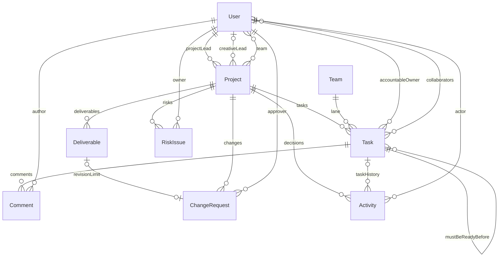
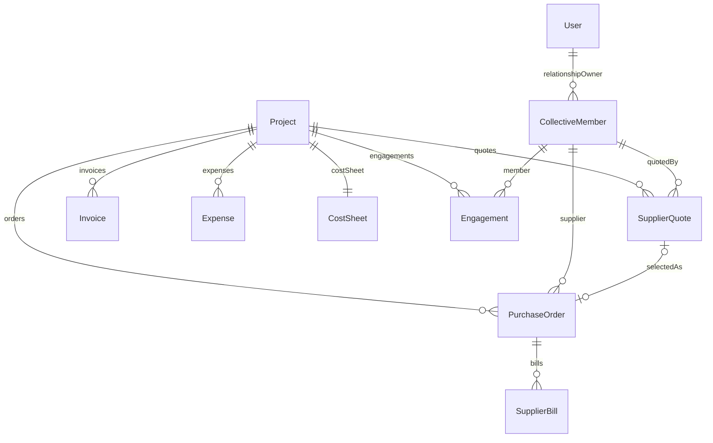
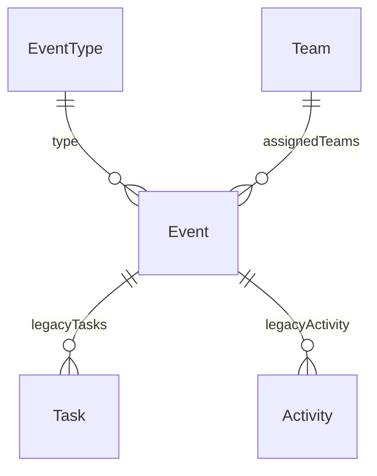

# MakeHappen backend data

Schema reference for the Express API. Models live in `api/src/models`. MongoDB is opened only by that process.

A line in the diagrams is an ObjectId with a Mongoose `ref`. An embedded block is stored inside its parent and has no collection of its own. Examples: client contacts, proposal lines, deliverable versions and reviews, project milestones, the closeout checklist, workstreams, asset links, the quality checklist, and cost-sheet lines.

`committedTotalCost` and `actualTotalCost` on a project are written by the API after it recalculates them. Committed cost is the unbilled remainder of purchase orders that are not cancelled. Actual cost is the sum of supplier bills and expenses. They are not typed in by hand.

## People and sales

| Collection | Model | Parent | What matters |
|---|---|---|---|
| Team | `Team.ts` | — | Unique `name`. Optional `leaderId`. |
| User | `User.ts` | Team | Unique `email`. `role` is `owner`, `leader`, or `member`. `functionalRoles` come from the studio role list. `teamId` is the primary lane. `laneIds` is every lane the person sits on. `reportsToId` is the manager. `isVacant` marks an open seat. |
| Client | `Client.ts` | User, optional | Embedded `contacts` (name, email, phone, primary flag). `status` is `lead`, `active`, or `inactive`. `paymentTermsDays`. Optional `relationshipOwnerId`. |
| Lead | `Lead.ts` | User | `stage` is `inquiry`, `contacted`, `discovery`, `proposal`, `on_hold`, `won`, or `lost`. Products, currency, estimated value, source, next action, follow-up date, and discovery notes. `convertedProjectId` is set when an approved proposal is confirmed. |
| Proposal | `StudioOps.ts` | Lead | `status` is `draft`, `internal_review`, `sent`, `under_discussion`, `approved`, `declined`, or `expired`. Scope in and out, assumptions, timeline, payment terms, finance margin check, and quotation `lines` are embedded. |
| FollowUp | `StudioOps.ts` | Lead or Client | Title, date, notes, and `done`. Either link may be empty. |

Confirming a project requires a proposal whose status is `approved`. The lead then points at the new project and its stage becomes `won`. Client matching on conversion uses company name and contact email together.

## Project delivery

| Collection | Model | Parent | What matters |
|---|---|---|---|
| Project | `Project.ts` | Client, User | Unique `code` (`MH-YYYY-NNN`). `stage` is one of the 11 studio stages. `bypassedStages` cannot include stages 01–05 or 11. `status` is `not_started`, `planning`, `in_progress`, `waiting_for_client`, `at_risk`, `on_hold`, `delivered`, or `closed`. `health` is `on_track`, `at_risk`, or `blocked`. Money fields: quoted value, approved contract value, estimated cost, contingency, internal hours, external cost estimate, revision fees, and `fxRateToBase`. `depositReceived`, `budgetApproved`, and `confirmationNotes` are the stage 04 gate. Milestones, closeout, workstreams, asset links, and the quality checklist are embedded. |
| Task | `Task.ts` | Project, Team | `status` is `backlog`, `todo`, `in_progress`, `waiting`, `in_review`, `approved`, `blocked`, or `done`. Priority is `urgent`, `high`, `medium`, or `low`. Category is `deliverable_prerequisite`, `continuous_support`, or `operational_internal`. `isGatePrerequisite` blocks a stage advance while the task is open. `dependsOnTaskIds` and `mustBeReadyBefore` point at other tasks. `workstreamKey` is `delivery` or `communication` when the API creates the parallel documentation tasks. |
| Comment | `Comment.ts` | Task | Author and body. |
| Deliverable | `Deliverable.ts` | Project | `status` is `draft`, `internal_review`, `sent_to_client`, `revision_required`, `approved`, or `final`. Versions and reviews are embedded. Only a review whose role is `client` sets `approved`. Other approvals set `internallyApproved`. `editedAfterApproval` is set when a new version is submitted after approval. |
| ChangeRequest | `ChangeRequest.ts` | Project | Unique `(projectId, code)`, shaped `CR-001`. Reason is `client_scope_addition`, `revision_limit_exceeded`, `site_condition`, or `budget_adjustment`. Status is `draft`, `submitted`, `client_approved`, or `client_rejected`. Stores the client approver name and evidence URL. Approval updates the contract value, estimated cost, and delivery date. |
| RiskIssue | `RiskIssue.ts` | Project | Severity is `critical`, `high`, `medium`, or `low`. Category is `timeline`, `budget`, `client_scope`, `fabrication_supplier`, `site_operations`, or `quality_craft`. Status is `open`, `mitigated`, or `resolved`. |
| Activity | `Activity.ts` | Project and optionally Task | `type` is `status`, `assignment`, `comment`, `edit`, or `decision`. `taskId` may be empty. Stage advances, owner overrides, and change-request approvals are `decision` rows. |

Stage advance moves only to the next stage that is not in `bypassedStages`. Open gate-prerequisite tasks block it. Leaving stage 04 needs a deposit or written confirmation. Leaving stages 06, 07, and 08 needs an approved deliverable. Leaving stage 08 also needs `budgetApproved`. Closeout sets `closed` only when the checklist is complete and there are no unpaid invoices, open purchase orders, or unpaid supplier bills.

## Money and the network

| Collection | Model | Parent | What matters |
|---|---|---|---|
| CollectiveMember | `CollectiveMember.ts` | User, optional | `type` is `maker`, `partner`, `contractor`, `supplier`, `venue`, `freelancer`, `brand_talent`, or `service_provider`. `status` is `active`, `vetted`, or `on_hold`. |
| PurchaseOrder | `PurchaseOrder.ts` | Project, CollectiveMember | Unique `poNumber`. `status` is `draft`, `issued`, `partially_billed`, `fully_billed`, or `cancelled`. `billedAmount` is the sum of bills recorded against it. |
| SupplierBill | `SupplierBill.ts` | PurchaseOrder | `status` is `received`, `approved`, or `paid`. `paidAt` is set when the bill is marked paid. |
| SupplierQuote | `Planning.ts` | Project, CollectiveMember | Compared before a purchase order exists. `selected` and `purchaseOrderId` are set when the quote is chosen. |
| Invoice | `Invoice.ts` | Project | Unique `(projectId, invoiceNumber)`. `status` is `not_invoiced`, `invoiced`, `partially_paid`, `paid`, or `overdue`. `amountPaid` supports a partial payment. `isDeposit` marks the stage 04 deposit. A planned milestone is an invoice left at `not_invoiced`. |
| Expense | `StudioOps.ts` | Project, optional | Category, description, amount, and date. Included in actual cost. This is spend that has no purchase order. |
| CostSheet | `Planning.ts` | Project | One document per project (`projectId` is unique). Embedded lines with estimated, committed, and actual amounts. `locked` rejects later edits. |
| Engagement | `Planning.ts` | Project, CollectiveMember | Role, agreed fee, and `status` of `proposed`, `confirmed`, or `complete`. Past work for a member is a query on this collection. |
| ProjectTemplate | `Planning.ts` | — | Product, default skipped stages, and embedded task and deliverable presets. Applying a template copies those onto a project. The template is not linked afterward. |

Currencies are `USD`, `AED`, `SAR`, and `EGP`. Reports keep each currency in its own total. `fxRateToBase` on the project is the rate captured for a base-currency figure. Amounts in different currencies are not added together.

## Studio operations

These collections are not on the project spine. They live in `StudioOps.ts` except where noted.

| Collection | Hangs from | What matters |
|---|---|---|
| QuarterlyGoal | User, optional | Year, quarter, title, target, and progress. |
| SalesTarget | — | Label, year, quarter, and amount. |
| MarketingItem | — | `kind` is `calendar`, `content`, `campaign`, `case_study`, `asset`, `pr`, or `website`. |
| LeaveRequest | User | Start, end, reason. `status` is `requested`, `approved`, or `declined`. |
| PerformanceReview | User | Period, notes, and a rating from 1 to 5. |
| ProductionUpdate | Project | `area` is `fabrication`, `installation`, or `handover`, plus a percent complete. |
| FounderDecision | — | `status` is `open` or `decided`, with an outcome. |

## Retired collections

`Event` and `EventType` remain in `api/src/models/Event.ts` and `api/src/models/EventType.ts` so old documents still validate. The product no longer has event screens. Tasks and activity rows may still carry an `eventId` from that period. New work is stored on projects.

| Collection | Model | What matters |
|---|---|---|
| EventType | `EventType.ts` | Unique `name`. |
| Event | `Event.ts` | Name, start, end, `typeId`, `teamIds`, and `notifiedTeamIds`. |
